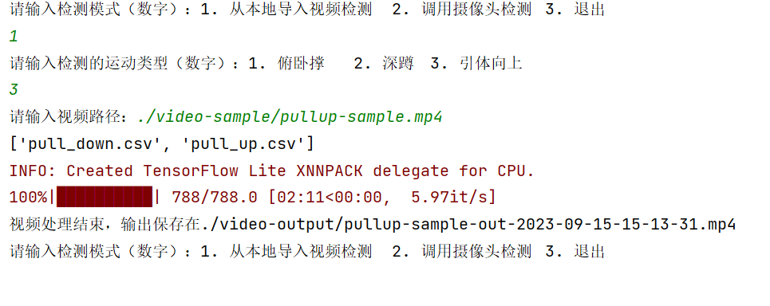

# Fitness Counter（MediaPipe 健身动作计数）

基于 [MediaPipe BlazePose](https://github.com/google-ai-edge/mediapipe) 的俯卧撑、深蹲、引体向上计数工具。输入视频或摄像头画面，输出带骨架、分类置信度曲线和计数的视频。

不需要训练神经网络：程序先从训练图片中提取 33 个 3D 人体关键点，转换成姿态特征向量，再用 k-NN 分类当前动作状态，最后通过双阈值计数。



## 功能

- 支持 **俯卧撑**、**深蹲**、**引体向上** 三种动作
- 支持本地视频文件、摄像头实时画面、交互式菜单
- 仓库自带训练好的 CSV，克隆后无需准备数据即可运行
- 也支持用自己的图片重建训练集
- 提供 Dockerfile，一条命令跑通本地视频
- 跨平台：Windows / Linux / macOS

## 环境要求

- Python 3.10 或 3.11（Docker 镜像使用 3.10）
- `mediapipe==0.10.21`
- 不需要 GPU

> **重要**：`mediapipe==0.9.1.0` 和 `0.8.10` 已从 PyPI 下架，旧版 `requirements.txt` 无法安装。本项目已锁定 `0.10.21`，并修复了 Pillow 10 / NumPy 2 的兼容问题。不要随意升级 `mediapipe`（1.x 不保证保留旧版 `solutions` API）。

## 快速开始

### 方式一：Docker（推荐，仅本地视频）

```bash
git clone https://github.com/hdtljg/fitness-counter.git
cd fitness-counter

docker build -t fitness-counter .
mkdir -p output        # PowerShell 用: mkdir output

docker run --rm \
  -v "$(pwd)/samples:/data/input:ro" \
  -v "$(pwd)/output:/data/output" \
  fitness-counter \
  --video /data/input/squat-sample-6s.mp4 \
  --exercise squat \
  --output /data/output/squat-out.mp4
```

macOS / Linux 使用上面的 `$(pwd)` 版本即可。Windows 用户按所用终端选择：

PowerShell：

```powershell
docker run --rm `
  -v "${PWD}/samples:/data/input:ro" `
  -v "${PWD}/output:/data/output" `
  fitness-counter `
  --video /data/input/squat-sample-6s.mp4 `
  --exercise squat `
  --output /data/output/squat-out.mp4
```

Git Bash（`MSYS_NO_PATHCONV=1` 防止 `/data/...` 被改写成 Windows 路径）：

```bash
MSYS_NO_PATHCONV=1 docker run --rm \
  -v "$(pwd -W)/samples:/data/input:ro" \
  -v "$(pwd -W)/output:/data/output" \
  fitness-counter \
  --video /data/input/squat-sample-6s.mp4 \
  --exercise squat \
  --output /data/output/squat-out.mp4
```

国内网络下首次构建如果很慢，可以换 Debian / PyPI 镜像（只影响构建，不写入镜像配置）：

```bash
docker build \
  --build-arg APT_MIRROR_HOST=mirrors.tuna.tsinghua.edu.cn \
  --build-arg PIP_INDEX_URL=https://pypi.tuna.tsinghua.edu.cn/simple \
  -t fitness-counter .
```

也可以直接用 Compose：

```bash
mkdir -p output
docker compose run --rm --build fitness-counter
```

输出视频在 `output/squat-out.mp4`。Docker 容器只支持**视频文件**模式；摄像头需要在本机 Python 环境运行（Windows/macOS 的 Docker Desktop 无法直接访问摄像头）。

> Docker 里务必用 `--output` 指向挂载目录（如 `/data/output/...`），否则输出会留在容器内部，容器退出后就找不到了。

### 方式二：本机 Python

```bash
python -m venv .venv

# Windows
.venv\Scripts\activate
# Linux / macOS
source .venv/bin/activate

pip install -r requirements.txt

python code/main.py \
  --video samples/squat-sample-6s.mp4 \
  --exercise squat \
  --output output/squat-out.mp4
```

有显示器的环境可以加 `--show` 实时预览。

### 摄像头

```bash
python code/main.py --camera --exercise squat
```

按英文状态下的 `q` 或 `Esc` 退出。

### 交互式菜单

不带参数运行会进入原版菜单：

```bash
python code/main.py
```

```
请输入检测模式（数字）：1. 从本地导入视频检测  2. 调用摄像头检测  3. 退出
```

## 支持的动作

| `--exercise` | 菜单编号 | 计数的姿态类 | 使用的 CSV |
|---|---|---|---|
| `pushup` | 1 | `push_down` | `push_up.csv` / `push_down.csv` |
| `squat` | 2 | `squat_down` | `squat_up.csv` / `squat_down.csv` |
| `pullup` | 3 | `pull_up` | `pull_up.csv` / `pull_down.csv` |

`--exercise` 还接受 `push-up`、`push_up`、`pull-up`、`pull_up` 等别名。

## 命令行参数

| 参数 | 说明 |
|---|---|
| `--video PATH` | 输入视频路径 |
| `--camera` | 调用摄像头 |
| `--exercise, -e NAME` | 运动类型：`pushup` / `squat` / `pullup` |
| `--output, -o PATH` | 输出视频路径；不填则写入 `video-output/` |
| `--show` | 处理视频时显示预览窗口，Docker/无显示器环境不要加 |
| `--camera-index N` | 摄像头编号，默认 `0` |

## 输出

- 默认输出目录：`code/video-output/`（相对于 `code/` 目录）
- 输出视频包含：人体骨架、分类置信度曲线、实时计数
- 输出视频不包含原视频的音频
- 人脸/身体画面会出现在输出中，分享前请自行确认隐私

## 用自己的数据重新训练

训练集是每个动作两个状态的图片。程序会自动提取关键点并生成 CSV。

### 目录结构

```
code/fitness_poses_images_in/
├── push_up/          # 或 squat_up / pull_up
│   ├── image_001.jpg
│   ├── image_002.jpg
│   └── ...
└── push_down/        # 或 squat_down / pull_down
    ├── image_001.jpg
    ├── image_002.jpg
    └── ...
```

- 文件夹名必须是 `<csv_prefix>_up` 和 `<csv_prefix>_down`：
  - 俯卧撑：`push_up` / `push_down`
  - 深蹲：`squat_up` / `squat_down`
  - 引体向上：`pull_up` / `pull_down`
- 只处理当前选择动作的两个文件夹，其他动作的文件夹会被忽略。
- 图片路径建议使用 ASCII 字符（OpenCV 在 Windows 上对中文路径支持不稳定）。
- 每个状态建议 15–25 张以上，最好覆盖不同拍摄角度；样本越多、角度越丰富，计数越稳定。

### 重建步骤

1. 按上面的结构放好图片。
2. 删除 `code/fitness_poses_csvs_out/` 中对应动作的两个 CSV，例如深蹲的 `squat_up.csv` 和 `squat_down.csv`。
3. 运行程序。缺少 CSV 时会自动：
   - 提取关键点，写入 `fitness_poses_csvs_out/`
   - 生成带骨架标注的图片到 `fitness_poses_images_out/`
   - 自动检测并删除离群样本
4. 重新运行一次计数程序。

> 当前 `pull_up.csv` / `pull_down.csv` 各只有 25 条样本，引体向上的计数稳定性弱于深蹲和俯卧撑。想要更好的效果，建议补拍样本后重建。

## 工作原理

```
视频帧
  → MediaPipe Pose 提取 33 个 3D 关键点
  → FullBodyPoseEmbedder 归一化（平移 + 缩放）并构造成对距离特征
  → PoseClassifier 两阶段 k-NN 投票
      · 先按最大距离取前 30 个样本
      · 再按平均距离取前 10 个样本投票
  → EMADictSmoothing 指数移动平均平滑
  → RepetitionCounter 双阈值（enter/exit）计数
  → Visualizer 把曲线和计数叠加到画面
```

## 项目结构

```
.
├── code/
│   ├── main.py                        # 命令行 / 交互式入口
│   ├── exercises.py                   # 动作与 CSV 的映射
│   ├── videoprocess.py                # 本地视频检测
│   ├── videocapture.py                # 摄像头检测
│   ├── poseembedding.py               # 关键点归一化与特征编码
│   ├── poseclassifier.py              # k-NN 姿态分类
│   ├── resultsmooth.py                # EMA 平滑
│   ├── counter.py                     # 重复计数
│   ├── visualizer.py                  # 分类曲线与计数可视化
│   ├── extracttrainingsetkeypoints.py # 图片 → 关键点 CSV
│   ├── trainingsetprocess.py          # 训练集生成 / 离群点处理
│   ├── video_to_frames.py             # 视频抽帧工具
│   ├── rename_images.py               # 图片批量重命名工具
│   ├── Roboto-Regular.ttf             # 计数显示字体
│   └── fitness_poses_csvs_out/        # 预置训练集 CSV
├── samples/                           # 可直接运行的短样例视频
├── Dockerfile
├── docker-compose.yml
├── requirements.txt
├── LICENSE
└── NOTICE
```

## 工具脚本

```bash
# 每 15 帧抽一张图到 frames/
python code/video_to_frames.py input.mp4 frames/ --interval 15

# 把图片按 image_001.jpg、image_002.jpg ... 重命名
python code/rename_images.py path/to/images --prefix image --start 1
```

## 常见问题

**`pip install` 找不到 mediapipe 0.9.1.0 / 0.8.10**

旧版本已被 PyPI 下架。使用本仓库锁定的 `mediapipe==0.10.21`，并保持 `numpy<2`。

**Windows 上 OpenCV 读不到视频/图片**

视频、图片和输出路径尽量使用纯英文/数字，不要包含中文或特殊字符。Docker Desktop 用户也建议把仓库放在纯英文路径下。

**Docker 里能调用摄像头吗？**

默认不行。Windows/macOS 的 Docker Desktop 不能直接访问摄像头。Linux 主机可以尝试 `--device=/dev/video0` 并转发 X11，但不建议作为主要用法。摄像头请在宿主机用 Python 运行。

**输出视频没有声音**

程序只处理画面，不会复制音轨。

**Docker 镜像为什么这么大？**

`mediapipe` 依赖 `jax` / `jaxlib`，镜像接近 1GB 属于正常现象。首次构建需要下载依赖，请耐心等待。

**`--show` 报错或无窗口**

`--show` 需要图形界面。Docker、SSH 或无显示器环境请去掉该参数，程序仍会正常写出视频文件。

**训练时内存占用很高**

关键点提取和离群点检测比较占内存，建议 16GB 及以上；样本很多时可以先用 `per_pose_class_limit` 做小规模调试。

## 许可证与致谢

本项目使用 [Apache License 2.0](LICENSE)。

姿态分类流程参考自 Google MediaPipe 的 pose classification 示例，MediaPipe 同样使用 Apache-2.0。原始健身计数文章：

- https://blog.csdn.net/m0_57110410/article/details/125569971

详见 [NOTICE](NOTICE)。
